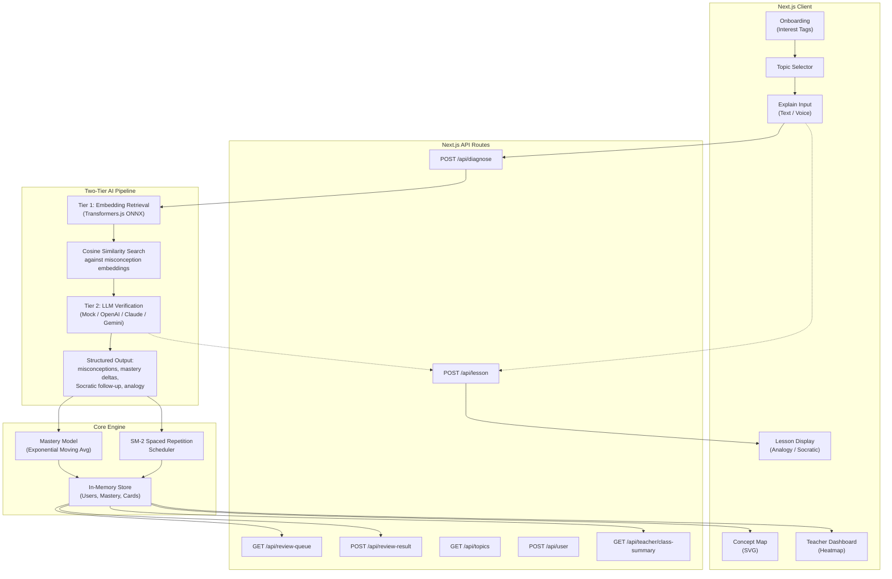

# Lucid — The AI Tutor That Finds Where Understanding Breaks

**Tagline:** The AI tutor that finds exactly where understanding breaks — and fixes it, personally.

[](https://www.typescriptlang.org/)
[](https://nextjs.org/)
[](https://tailwindcss.com/)
[](LICENSE)

> **Hackathon Submission** — Built for the Prometheus Hackathon (July 2026).
>
> *Categories:* Educational Impact (25%) · Creative Use of AI/ML (25%) · Technical Execution (25%) · Pitch & Demo (25%)

---

## Problem Statement

Most AI tutors check whether an answer is **right or wrong**. A student types an answer, the system says "incorrect," and the student moves on — still holding the same misconception.

**This doesn't teach.**

Lucid uses the **Feynman Technique**: have the student explain a concept in their own words, then diagnose the *specific* misconception behind any confusion. Not "you're wrong" but *"you believe X, which is why you're stuck."* Then it teaches directly to that gap with a personalized analogy.

---

## Solution Overview


Lucid's web app lets a student:
1. **Pick 2–3 interests** (sports, gaming, cooking, etc.) to personalize analogies
2. **Choose a topic** from a curated set (Physics, Biology, CS, Psychology)
3. **Explain the concept in their own words** — typed or spoken
4. **Receive a precise diagnosis** of the misconception(s) detected, with evidence quotes
5. **Watch a concept map animate** as sub-concept mastery scores update (red → yellow → green)
6. **Get a personalized micro-lesson** with an analogy tied to their interests, a Socratic follow-up, and a reading-level toggle

A **Teacher Dashboard** aggregates class mastery as a heatmap and surfaces the single most common misconception across all students.

---

## Architecture



### The Two-Tier Pipeline (This Is the Real AI)

**Tier 1 — Retrieval (the genuine ML step):**
- At startup, every canonical misconception in the taxonomy is embedded into a 384-dimensional vector using **all-MiniLM-L6-v2** (via Transformers.js, runs locally in Node.js with ONNX — no external API needed).
- When a student submits an explanation, it's embedded the same way.
- Cosine similarity is computed against every misconception embedding within the selected topic.
- The top candidates above a threshold are passed to Tier 2.

```typescript
similarity(a, b) = dot(a, b) / (norm(a) * norm(b))

topCandidates = misconceptions[topic]
  .map(m => ({ ...m, score: cosineSim(studentEmbedding, m.embedding) }))
  .sort((a, b) => b.score - a.score)
  .filter(m => m.score > THRESHOLD)
  .slice(0, 3)
```

**Tier 2 — Verification + Generation (the LLM step):**
- The student's explanation + Tier 1 candidates are passed to an LLM call with a **structured output schema** (JSON mode / tool calling — no free-text parsing).
- The LLM confirms or rejects each candidate with a quoted piece of evidence from the student's own words.
- It outputs mastery deltas per sub-concept, a Socratic follow-up question, and a personalized analogy.

> **Why this architecture?** Grounding the LLM in retrieved candidates instead of asking it to invent a diagnosis from scratch is a **mini-RAG pattern** — it reduces hallucination and is a legitimate, explainable architecture choice.

---

## Tech Stack

| Layer | Technology | Why |
|-------|-----------|-----|
| **Frontend** | Next.js 16 + Tailwind CSS 4 | App Router, server/client components, fast styling |
| **Backend** | Next.js API Routes | Same repo, no extra deployment |
| **Embeddings** | Transformers.js (all-MiniLM-L6-v2) | Local ONNX inference — no API needed, <80MB model |
| **LLM** | Pluggable (Mock / OpenAI / Anthropic / Gemini) | Structured output via JSON mode |
| **Storage** | In-memory (Map-based store) | Hackathon shortcut — swap for Supabase/PostgreSQL |
| **Icons** | Lucide React | Consistent icon system |
| **Fonts** | Inter + JetBrains Mono | Clean, modern typography |

---

## Seed Content (Hand-Authored Taxonomies)

Lucid ships with **4 hand-authored topics** from different domains to prove the system generalizes:

| # | Topic | Domain | Sub-Concepts | Misconceptions |
|---|-------|--------|-------------|----------------|
| 1 | Newton's Second Law (F = ma) | Physics | 2 | 5 |
| 2 | Photosynthesis | Biology | 3 | 6 |
| 3 | Recursion | Computer Science | 3 | 6 |
| 4 | Cognitive Biases | Psychology | 3 | 6 |

Each misconception includes a **Socratic probe** — a follow-up question that doesn't give the answer but nudges the student toward noticing the gap themselves.

---

## Setup & Run

### Prerequisites
- Node.js >= 18
- npm >= 9

### Quick Start

```bash
# Clone the repo
git clone https://github.com/ibnshafi/lucid.git
cd lucid

# Install dependencies
npm install

# Copy environment variables (no API keys needed for mock mode)
cp .env.example .env.local

# Start the dev server
npm run dev
```

Open [http://localhost:3000](http://localhost:3000) and click **Start Learning**.

### Configuration

| Variable | Default | Description |
|----------|---------|-------------|
| `LLM_PROVIDER` | `mock` | `mock`, `openai`, `anthropic`, or `gemini` |
| `OPENAI_API_KEY` | — | Required if `LLM_PROVIDER=openai` |
| `ANTHROPIC_API_KEY` | — | Required if `LLM_PROVIDER=anthropic` |
| `EMBEDDING_MODEL` | `Xenova/all-MiniLM-L6-v2` | Transformers.js model name |

> **Note:** The app works fully in **mock mode** without any API keys. The mock LLM provider returns sensible canned responses so you can demo the entire flow. To use real LLM-powered diagnosis, set `LLM_PROVIDER` and the corresponding API key.

---

## Learning Science Grounding

Lucid is built on three evidence-based pedagogical principles:

### 1. Retrieval Practice (Feynman Technique)
The Feynman Technique states that if you can't explain something simply, you don't understand it well enough. By having students **generate their own explanations** instead of selecting from multiple choices, Lucid forces retrieval from long-term memory — one of the most effective learning strategies (Roediger & Karpicke, 2006).

### 2. Misconception-Based Diagnosis
Rather than scoring answers as right/wrong, Lucid identifies the **specific faulty mental model** behind an error. This is grounded in the constructivist theory of learning (Piaget, Vosniadou) — that learners build mental models, and effective teaching targets the *gap* between the learner's current model and the correct one.

### 3. Spaced Repetition (SM-2 Algorithm)
Lucid implements the **SM-2 algorithm** (SuperMemo 2, Wozniak 1987) — a real, citable spaced repetition algorithm. Each sub-concept gets a review card with an ease factor and interval that lengthens as the student demonstrates mastery. Concepts are resurfaces right before the student would likely forget them, optimizing long-term retention.

---

## API Contract

The frontend and backend communicate through a clean REST API:

| Method | Endpoint | Description |
|--------|----------|-------------|
| `POST` | `/api/diagnose` | Run full diagnosis pipeline |
| `POST` | `/api/lesson` | Generate personalized micro-lesson |
| `GET` | `/api/review-queue` | Get due review items for a user |
| `POST` | `/api/review-result` | Submit a review result (SM-2 update) |
| `GET` | `/api/topics` | List available topics |
| `POST` | `/api/user` | Create/update user profile |
| `GET` | `/api/teacher/class-summary` | Aggregate class mastery data |

Full request/response schemas are documented in [`src/types/index.ts`](src/types/index.ts).

---

## Demo Script (2:00)

### Shot List

| Time | Visual | Audio / Caption |
|------|--------|----------------|
| 0:00–0:20 | A student-facing camera says "F=ma means heavier things always accelerate slower." | Most tutors would say "incorrect." Watch Lucid name the *exact* misconception. |
| 0:20–0:35 | Split screen: Lucid UI shows diagnosis result + concept map animating — a node shifts from red to yellow. | "It found the specific belief behind the mistake — and the concept map tracks your understanding live." |
| 0:35–0:55 | Side-by-side: Same physics concept explained through "gaming" (player stats) vs "cooking" (heat & ingredients). | "Same concept, two different interests. Lucid personalizes every analogy." |
| 0:55–1:15 | Teacher dashboard: heatmap with 4–5 students, colored squares. The "most common misconception" callout. | "Teachers see a whole class's mastery at a glance — and the single misconception to address right now." |
| 1:15–1:35 | Review queue screen: card due for review with SM-2 stats. | "Spaced repetition using the SM-2 algorithm — resurfaces concepts right when they'd start to fade." |
| 1:35–1:50 | Quick toggles: reading level (Simple→Standard→Advanced), TTS plays the explanation aloud. | "Accessibility built in: reading level toggle, text-to-speech, dyslexia-friendly fonts." |
| 1:50–2:00 | Close on the tagline. | "Lucid doesn't check answers. It finds where understanding breaks — and fixes it, personally." |

---

## Current Limitations

- **In-memory storage** — All data is lost on server restart. A production version would use PostgreSQL (via Supabase) or similar.
- **Mock LLM provider** — The demo uses a canned response provider. Connect an OpenAI/Claude API key for real AI-generated diagnoses and analogies.
- **SM-2 scheduler not proactive** — The review queue endpoint is implemented but the app doesn't yet proactively surface review items (the UI hook is straightforward to add).
- **Single-language** — Currently English-only. The taxonomy approach could extend to any language with a new seed content file.
- **Voice input limited** — Uses browser Web Speech API (Chrome/Edge). For production, the Whisper API integration would provide better accuracy cross-browser.

---

## Roadmap

- [x] Two-tier AI pipeline (embedding retrieval + LLM verification)
- [x] Animated concept map visualization
- [x] Personalized analogy generation (4+ interest domains)
- [x] Teacher dashboard with class heatmap
- [x] SM-2 spaced repetition scheduler
- [x] Reading-level toggle
- [x] Text-to-speech support
- [ ] Proactive review reminders (push notifications / email)
- [ ] Real PostgreSQL persistence
- [ ] Real LLM provider integrations (OpenAI, Anthropic, Gemini)
- [ ] Student progress history and streaks
- [ ] Collaborative class mechanics
- [ ] Student-created topics and misconceptions

---

## Project Structure

```
lucid/
├── src/
│   ├── app/
│   │   ├── page.tsx                # Landing page
│   │   ├── onboard/page.tsx        # Interest tag selection
│   │   ├── learn/page.tsx          # Topic selection + explain input
│   │   ├── lesson/page.tsx         # Diagnosis results + concept map + lesson
│   │   ├── dashboard/page.tsx      # Teacher dashboard
│   │   └── api/                    # API routes
│   ├── components/
│   │   ├── ConceptMap.tsx          # SVG force-directed graph (hero visual)
│   │   ├── MisconceptionCard.tsx   # Detected misconception display
│   │   ├── LessonDisplay.tsx       # Analogy + Socratic question
│   │   └── TeacherHeatmap.tsx      # Class mastery heatmap table
│   ├── lib/
│   │   ├── embeddings.ts           # Transformers.js embedding service
│   │   ├── tier1-retrieval.ts      # Cosine similarity retrieval
│   │   ├── tier2-llm.ts            # LLM provider + mock implementation
│   │   ├── pipeline.ts             # Orchestration: embed → tier1 → tier2
│   │   ├── mastery-model.ts        # EMA mastery + SM-2 algorithm
│   │   ├── seed-content.ts         # 4 hand-authored topic taxonomies
│   │   └── store.ts                # In-memory data store
│   └── types/index.ts             # All TypeScript types
├── .env.example
└── README.md
```

---

## License

MIT — free for educational and hackathon use.

---

*Built with ❤️ for the Prometheus Hackathon, July 2026.*
